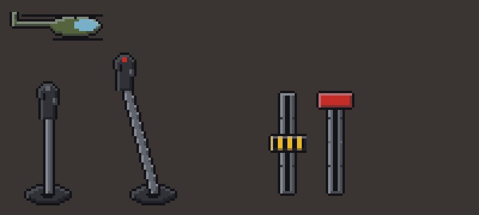

# HalfGripHelicopter

**Version 0.1.0** · for Half Grip 0.418 · needs [HalfGripTools](https://github.com/4l3x4nd3r0/HalfGripTools) 1.0.2+

A chassis item, **Helicopter**, that turns your car into a helicopter. Made for the
[Open World](https://github.com/htubdawg/HalfGripOpenWorld) mod, but it works in any race.

## What it does

- **It fits alone.** Put the Helicopter in the chassis slot and everything else goes back in the hold. Nothing else can go in while
  it's there. The same holds for a refit in the Open World's garages and for a saved loadout.
- **New cockpit.** The steering wheel, shifter and handbrake are gone. In their place:
  - **Stick** (where the wheel was): grab it and push. Forward/back pitches the nose, left/right banks and turns. Let go and it
    springs back to the middle, and the helicopter levels out into a hover. **Right click** holds it where it is (the button on top
    turns red) and frees it again.
  - **Collective** (yellow, left lever): how hard the rotor lifts. **Half way (the yellow mark) hovers**, above climbs, below sinks.
  - **Throttle** (red, right lever): the rotor's speed. It takes a few seconds to spin up. The rev dial and engine sound follow it.
  - The levers stay where you leave them.
- **No keys.** W and S do nothing. Everything is done with the hand.
- In the **Open World**, land in a garage and drop the collective to the bottom, then let go of it. That opens the garage (instead of
  letting go of the shifter in neutral). The same signs you on to an event.
- No Big Air achievement while the Helicopter is fitted.

## How to fly

1. Push the throttle to the top and wait for the rotor to spin up.
2. Raise the collective past the yellow mark. The helicopter lifts off.
3. Take the stick and fly. Let go to hover.
4. To land, bring the collective a little below the mark and let it settle.

## Install

Copy only the `Helicopter` folder into `<game>\BepInEx\HalfGripMods\`, so that `mod.json` sits directly in
`HalfGripMods\Helicopter\`. Not the whole repository download.

## Settings

`BepInEx\config\halfgrip.helicopter.cfg`:

| Setting | Default | Meaning |
|---|---|---|
| `Flight.TopSpeed` | 140 | Top speed at full stick, game units a second (the car tops out near 100) |
| `Flight.ClimbRate` | 30 | Climb rate at full collective, game units a second |
| `Flight.MaxTilt` | 30 | How far the stick tilts the helicopter, degrees |
| `Flight.SpoolSeconds` | 4 | Rotor spin-up time from rest |
| `Debug.VerboseLog` | false | Write what the mod does to `BepInEx\LogOutput.log` |
