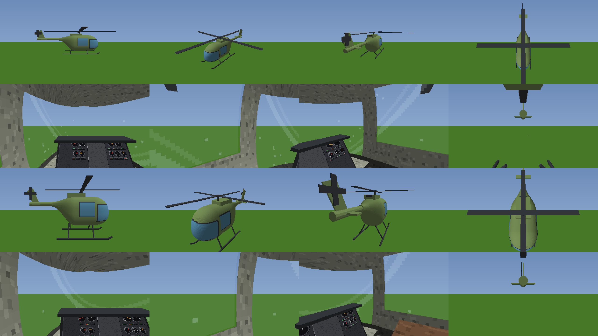

# HalfGripHelicopter

**Version 0.2.5** · for Half Grip 0.418 · needs [HalfGripTools](https://github.com/4l3x4nd3r0/HalfGripTools) 1.0.2+

A chassis item, **Helicopter**, that turns your car into a helicopter. Made for the
[Open World](https://github.com/htubdawg/HalfGripOpenWorld) mod, but it works in any race.

### ▶ Watch it fly

[](https://www.youtube.com/watch?v=4XyWdDLQcCk)

A short showcase of the Helicopter in game. *(Click the picture to watch it on YouTube.)*


## What it does

- **It fits with guns only.** Put the Helicopter in the chassis slot and everything else goes back in the hold, except guns and the
  [MiniMap](https://github.com/htubdawg/HalfGripMiniMap) mod's GPS. Nothing else can go in while it's there. The same holds for a refit in the Open World's garages and for a saved loadout.
- **New cockpit.** The steering wheel, shifter and handbrake are gone, and so are the car's speed and rev dials, gear box and
  rear-view mirror, money and enemy-targeting lights (the board at the top right stays). In their place:
  - **Stick** (where the wheel was, a big grip standing up from the floor): grab it and push. Forward/back pitches the nose, left/right banks and turns. Let go and it
    springs back to the middle, and the helicopter levels out into a hover. **Right click** locks it (the button on top
    turns red): you can still grab and move it, but let go it stays where you left it. Right click again frees it.
  - **Collective** (yellow, left lever): how hard the rotor lifts. **Half way (the yellow mark) hovers**, above climbs, below sinks.
  - **Throttle** (red, right lever): the rotor's speed. It takes a few seconds to spin up. The engine sound follows it.
  - The levers stand in a gate plate where the shifter was and stay where you leave them.
- **It looks like one.** From outside the car's body and wheels are gone: a fuselage with a glass nose and door windows and an engine housing on top, a tail boom with
  a fin and tail rotor, skids, and a main rotor that spins with the throttle. From the seat you look out through the
  tinted bubble windscreen and door windows from a cabin with a roof, walls, a floor, two seats and an instrument panel
  (gauges, radio, warning lights, switches) laid out round the stick and the levers, with a centre console under the levers
  and, with the MiniMap's GPS fitted, a grey mounting plate the GPS sits on.

  
- **No keys.** W and S do nothing. Everything is done with the hand.
- In the **Open World**, land in a garage and drop the collective to the bottom, then let go of it. That opens the garage (instead of
  letting go of the shifter in neutral). The same signs you on to an event.
- No Big Air achievement and no "AirTime" combo on the screen while the Helicopter is fitted.
- **Multiplayer:** in a room of the [Multiplayer mod](https://github.com/4l3x4nd3r0/HalfGripMods), the others see your
  helicopter, rotors turning, instead of your car. This needs HalfGripTools 1.0.6+ (Multiplayer needs it anyway).

## How to fly

1. Push the throttle to the top and wait for the rotor to spin up.
2. Raise the collective past the yellow mark. The helicopter lifts off.
3. Take the stick and fly. Let go to hover.
4. To land, bring the collective a little below the mark and let it settle.

## Install

### Easy way: the HalfGripMods installer

1. Download `HalfGrip-Mods-Installer.exe` from the newest release of
   [HalfGripMods](https://github.com/4l3x4nd3r0/HalfGripMods/releases) and double-click it. If Windows says "Windows protected
   your PC", press **More info**, then **Run anyway**. It finds the game through Steam (or asks for its folder) and installs
   BepInEx and HalfGripTools for you.
2. Close the game. Press **+ ADD** and paste this link to the mod's folder:
   ```
   https://github.com/htubdawg/HalfGripHelicopter/tree/main/Helicopter
   ```
   Then press **INSTALL** on the Helicopter's card.
3. Start the game from Steam. The first start takes a little longer while the mods compile.

Add [Open World](https://github.com/htubdawg/HalfGripOpenWorld) and [MiniMap](https://github.com/htubdawg/HalfGripMiniMap) (for
the GPS) the same way, using their own links. **CHECK NOW** in the installer looks for updates.

### By hand

Install BepInEx 5 and [HalfGripTools](https://github.com/4l3x4nd3r0/HalfGripTools) 1.0.2+ as its README says. Then copy only the
`Helicopter` folder into `<game>\BepInEx\HalfGripMods\`, so that `mod.json` sits directly in `HalfGripMods\Helicopter\`, not
the whole repository download.

## Settings

`BepInEx\config\halfgrip.helicopter.cfg`:

| Setting | Default | Meaning |
|---|---|---|
| `Flight.TopSpeed` | 140 | Top speed at full stick, game units a second (the car tops out near 100) |
| `Flight.ClimbRate` | 30 | Climb rate at full collective, game units a second |
| `Flight.MaxTilt` | 30 | How far the stick tilts the helicopter, degrees |
| `Flight.TiltResponse` | 3 | How quickly it pitches and banks to follow the stick (lower is gentler; 0.1.8 was 5) |
| `Flight.TiltRate` | 30 | The fastest it pitches or banks, degrees a second |
| `Flight.SpoolSeconds` | 4 | Rotor spin-up time from rest |
| `Debug.VerboseLog` | false | Write what the mod does to `BepInEx\LogOutput.log` |
